  

  
  
  
  
  
  
  

## Sobre

Construo sistemas backend, automação e IA aplicada em produção. Graduando em **Engenharia de Software (UCSal · 2028)** e Técnico em TI pelo **IFBA**.

- **Produção & SaaS:** Autor do [**MentoraOS**](https://mentoraos.com) (SaaS B2B multi-tenant em produção) e fundador/Tech Lead do [**Vox AI**](https://github.com/emn-f/vox-ai) (assistente RAG open source).
- **Corporativo & SecOps:** Atuação na **Continental** com gestão de identidades (IAM via Active Directory), hardening de endpoints e automação em Python + PowerShell (`Odé CLI` e `KillerOffice`).
- **Dados & Backend:** 4+ anos de prática em tecnologia, incluindo rotinas SQL/ETL, migrações de legados e investigação de causa raiz em produção (Freire Informática e Naxtool Sistemas).
- **Pesquisa & Comunidade:** Palestrante no **NOSS 2026**, autor de submissão ao **32º Prêmio Jovem Cientista (CNPq 2026)** e 1º lugar no **Prêmio Jovem na Ciência (2019)**.

> 🌐 Estudos de caso completos, diagramas de arquitetura, demos e trajetória bilíngue em **[emn-f.github.io/holmes](https://emn-f.github.io/holmes/pt-br/)**.

---

## Projetos em destaque

### 1. Vox AI *(Open Source · RAG & DevSecOps)*
Assistente de apoio e informação segura para a população LGBTQIA+ em Salvador, com *Anonymity by Design* (zero PII).

| Problema | Arquitetura | Resultado |
| :--- | :--- | :--- |
| MVP com planilhas, JSON e `sentence-transformers` local baixando modelo a cada boot | Backend Python desacoplado com **Supabase (`pgvector`)**, **Gemini API** e RAG | **~80% menos RAM** e maior concorrência em produção |
| Revisão manual de segurança e migrations | Esteira no **GitHub Actions** com **Gatekeep** (review com IA) e **Semgrep** | PRs, segredos e integridade validados automaticamente |

🔗 [Repositório](https://github.com/emn-f/vox-ai) · [Documentação](https://emn-f.github.io/vox-ai-docs/) · [App em produção](https://vox-ai.streamlit.app/)

### 2. MentoraOS *(SaaS B2B Multi-Tenant · Produção)*
Plataforma de gestão pedagógica para instituições de ensino dividida em **Control Plane** (`mentora-adm`, onboarding zero-touch) e **Data Plane** (`mentora-os`).
- **Segurança & Isolamento:** PostgreSQL com Row Level Security (**RLS**), criptografia em repouso (`AES-256-GCM`), hashing `Argon2id`, segredos por tenant no **Infisical** e armazenamento privado no **Cloudflare R2**.
- **Stack & Deploy:** React 19, Node.js, Express 5, deploy containerizado na **OCI** (GHCR + Trivy) e revisão de PRs assistida por IA via **Gatekeep**.

🔗 [mentoraos.com](https://mentoraos.com) · [app.mentoraos.com](https://app.mentoraos.com)

### 3. Odé CLI & KillerOffice *(Automação Corporativa, SecOps & FinOps · Continental)*
- **Odé CLI:** Orquestrador Python + agentes PowerShell para auditoria e remediação remota de softwares não homologados, eliminando interrupções manuais com usuários e reduzindo em **~90% o tempo dos auditores** (validado em 40+ testes).
- **KillerOffice:** Diagnóstico *read-only* para elegibilidade e auditoria de licenciamento **Microsoft Office 365**, apoiando decisões de FinOps e otimização de ativos de TI sem impacto nos endpoints.

---

## Outros projetos

- [**Respire**](https://respiretea-mvp.vercel.app/) *(Beta)* — Serious game narrativo de cartas táticas para flexibilidade cognitiva, controle inibitório e autorregulação (respiração 4-7-8) de jovens com TEA (`React 19 · TypeScript · Tailwind · Vitest`).
- [**PsiBook**](https://psibook-site.vercel.app) — Prontuário eletrônico e gestão clínica para psicólogos com isolamento via Supabase RLS, Zod e *Privacy Shield* em 1 clique (`Next.js 15 · TypeScript · Supabase`).
- [**Sonitus**](https://github.com/emn-f/sonitus) *(Open Source)* — Mapa comunitário de ruído urbano voltado à acessibilidade sensorial de pessoas com TEA (Extensão UCSal).
- **mentora-pw** — CLI que trata a gravação de demos de produto como código via Playwright headless + FFmpeg (`TypeScript · Playwright · FFmpeg`).
- **bomberman-sd** — Bomberman multiplayer 1v1 com **Java RMI** e *Local HTTP Adapter (Bridge)* integrado a um frontend React, com testes de concorrência em JUnit 5.
- [**EcoCílios**](https://github.com/emn-f/ecocilios) & [**Plumbum**](https://github.com/emn-f/plumbum) — Prevenção de enchentes urbanas com IoT e biomimética (Extensão UCSal) e plataforma de correção de textos (Pesquisa IFBA).

---

## Pesquisa, palestra & escritos

- 📄 **32º Prêmio Jovem Cientista (CNPq 2026):** *Vox AI: Inteligência Artificial e Ética no Acesso a Direitos Civis* — avaliação quantitativa LLM-as-a-Judge em 65 cenários com **94,5% de fidelidade normativa** e **85,1% de revocação** ([Ler artigo PDF](https://drive.google.com/file/d/10Ln4yzmlf9YjXhTkt5MzPCfZjReVknlD/view?usp=drivesdk) · [Repositório `/cnpq`](https://github.com/emn-f/vox-ai/tree/develop/cnpq)).
- 🎤 **Palestra (NOSS 2026):** *De Sheets a um RAG escalável: como evoluí a arquitetura do Vox AI* ([Assistir no YouTube](https://www.youtube.com/live/2GLyGSolizQ?t=15600&is=V7f9KamR9Vuf0V3I)).
- 🏆 **Publicação & Prêmio (2019 / 2021):** *Baralho Inorgânico: Um jogo para aprender funções químicas* — 1º lugar no Prêmio Jovem na Ciência 2019 e publicado na Revista Jovens Cientistas ([Ler artigo PDF](https://encontrodejovenscientistas.wordpress.com/wp-content/uploads/2021/11/revista-jc_2021_final_19-11_2.pdf)).
- 📝 **Medium:** [Do MVP ao RAG: Como o Vox AI evoluiu de planilhas para uma arquitetura escalável com Supabase](https://emnferreira.medium.com/do-mvp-ao-rag-como-o-vox-ai-evoluiu-de-planilhas-para-uma-arquitetura-escal%C3%A1vel-com-supabase-4c51b951ed56)
- 🛡️ **LinkedIn:** [Gatekeep: DevSecOps e code review com IA no Vox AI](https://lnkd.in/p/enFbtGYi)

---

## Tech Stack

  

 

  

---

  <picture>
    <source media="(prefers-color-scheme: dark)" srcset="https://raw.githubusercontent.com/emn-f/emn-f/refs/heads/output/github-contribution-grid-snake-dark.svg" />
    <source media="(prefers-color-scheme: light)" srcset="https://raw.githubusercontent.com/emn-f/emn-f/refs/heads/output/github-contribution-grid-snake.svg" />
    
  </picture>

